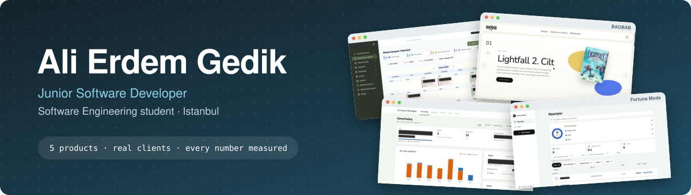
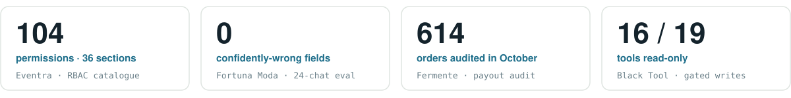
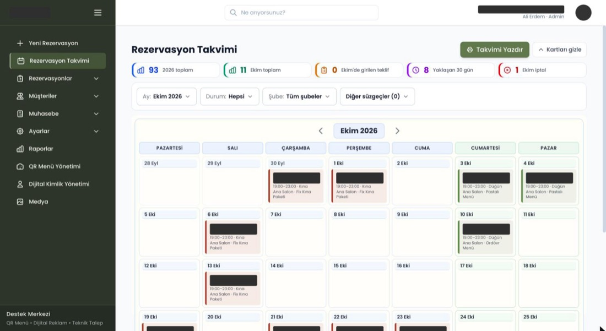
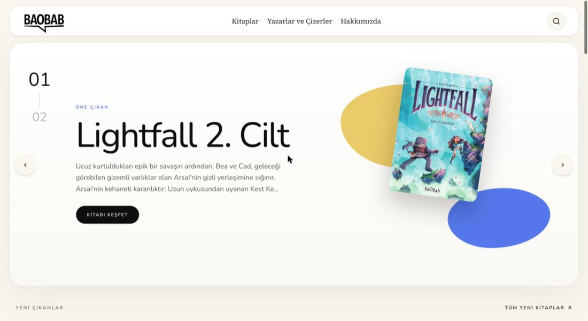
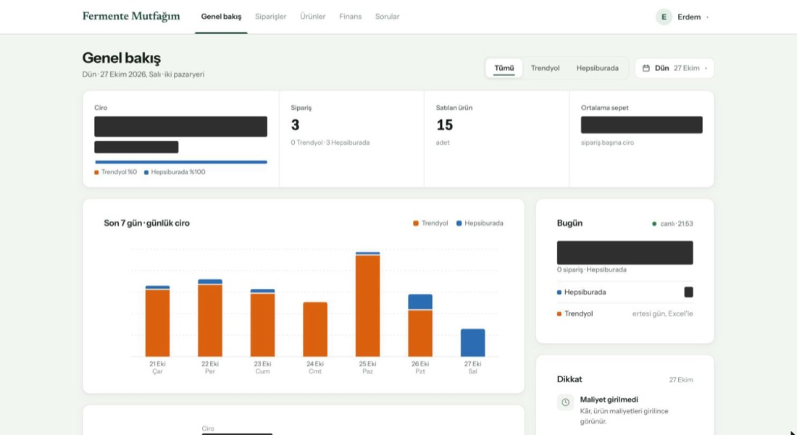
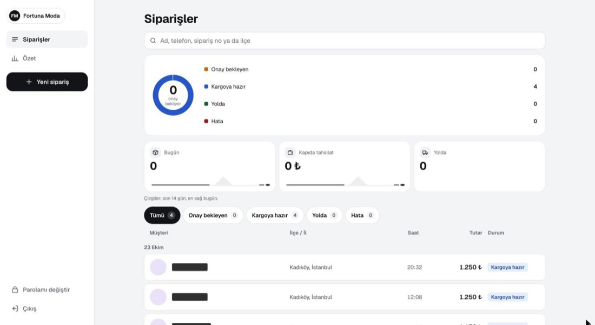
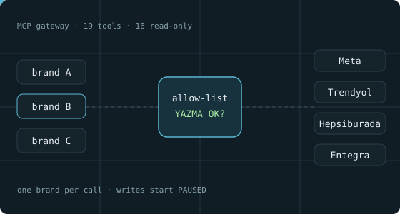

<picture>
  <source media="(prefers-color-scheme: dark)" srcset="assets/banner-dark.svg">
  
</picture>

  
  
  

Third-year Software Engineering student in a fully English-taught program and part-time Junior
Software Engineer at **Black Wool** since January 2026. I build business systems for real clients,
from the first requirements meeting to the release pipeline, and I care most about the parts that
keep them honest: permissions, data integrity, privacy and measured results.

<picture>
  <source media="(prefers-color-scheme: dark)" srcset="assets/numbers-dark.svg">
  
</picture>

| Focus | Measured result |
|---|---|
| **Authorization** | 104 permissions across 36 sections, database-defined roles, field-level visibility for ID numbers and payments — Eventra |
| **Concurrency** | Double booking prevented by locking the hall row inside the transaction; the losing request gets `409 Conflict` — Eventra |
| **Privacy by design** | A marketplace dashboard that never stores buyer personal data; the Excel import stops on any unexpected column — Fermente Paneli |
| **AI with guardrails** | AI reads, code decides: 0 confidently-wrong fields on the evaluation set; AI tools that write only after an exact approval phrase — Fortuna Moda, Black Tool |
| **Measured quality** | 424 test cases in Black Tool, 236 in Fortuna Moda, 189 check scripts in Eventra |

## Selected work · Black Wool

Source code is private; every link is a public case study with masked screenshots, diagrams and the measurements behind each number.

<table>
<tr>
<td colspan="2" valign="top">

### [Eventra](https://github.com/aeg58/eventra-case-study)
Project Lead & Developer · in production since Sep 2026 · v1.2.0

Reservation, finance and operations platform a wedding venue runs its daily business on — calendar across two branches, settings-driven booking form, deposits and cash boxes, contracts as server-side PDFs, 13 reports, QR menu and digital business card. 56 models · 109 API routes · 72 screens.

    
</td>
</tr>
<tr>
<td width="50%" valign="top">

### [BAOBAB](https://github.com/aeg58/baobab-case-study)
Developer · live since Oct 2026

Catalogue and editorial admin for a comics publisher. Page-flip previews, slug history with permanent redirects, JSON-LD in 12 schema.org types.

  
</td>
<td width="50%" valign="top">

### [Fermente Paneli](https://github.com/aeg58/fermente-panel-case-study)
Project Lead & Developer · on its own server

Read-only sales, profit and payout-audit dashboard across Trendyol and Hepsiburada. GET-only collector; no buyer personal data stored.

  
</td>
</tr>
<tr>
<td valign="top">

### [Fortuna Moda](https://github.com/aeg58/fortuna-moda-case-study)
Project Lead & Developer · panel live since Oct 2026

WhatsApp and Instagram orders turned into checked DHL eCommerce shipments. AI reads, code decides; 236 test cases.

  
</td>
<td valign="top">

### [Black Tool](https://github.com/aeg58/black-tool-case-study)
Project Lead & Developer · internal tool

MCP gateway that lets an AI assistant read client ad and marketplace accounts brand by brand. 16 of 19 tools read-only; writes need `YAZMA OK` and start paused.

  
</td>
</tr>
</table>

## Systems, algorithms & data

Individual coursework, documented as standalone repositories; each README states the course context.

| Repository | What it shows |
|---|---|
| [posix-pi-benchmark](https://github.com/aeg58/posix-pi-benchmark) · C | **3.67×** at 4 threads on 4 cores, flat beyond — the plateau is the hardware limit, not a defect |
| [shortest-path-algorithms](https://github.com/aeg58/shortest-path-algorithms) · C | BFS, Dijkstra and A* over 1,000 vertices; the A* heuristic is kept **admissible**, so it matches Dijkstra |
| [max-flow-min-cost](https://github.com/aeg58/max-flow-min-cost) · C++ | Edmonds–Karp and min-cost max flow written from scratch on a residual graph |
| [clustering-algorithms-comparison](https://github.com/aeg58/clustering-algorithms-comparison) · Python | Seven algorithms, six metrics — the best silhouette score picks the *least* informative model |
| [budget-planner](https://github.com/aeg58/budget-planner) · Java | PBKDF2-HMAC-SHA256 password storage with constant-time verification |

More: [recursive-file-copy](https://github.com/aeg58/recursive-file-copy) · [algorithm-task-3](https://github.com/aeg58/algorithm-task-3) · [statistical-analysis-report](https://github.com/aeg58/statistical-analysis-report) · [conference-hall-reservation](https://github.com/aeg58/conference-hall-reservation) · [snake-game-js](https://github.com/aeg58/snake-game-js) · [tourism-equipment-rental-uml](https://github.com/aeg58/tourism-equipment-rental-uml)

## Stack

      
        
     

**Certifications:** [HackerRank Software Engineer](https://www.hackerrank.com/certificates/6971d09ac7a7) · [Software Engineer Intern](https://www.hackerrank.com/certificates/c62b37e63cdb) · [Problem Solving (Intermediate)](https://www.hackerrank.com/certificates/41b9bc04dbe3) · [SQL (Advanced)](https://www.hackerrank.com/certificates/91a62c957726) · Anthropic Claude Code 101 and Claude Code in Action · English B2 (FSMEPT 71/100)
